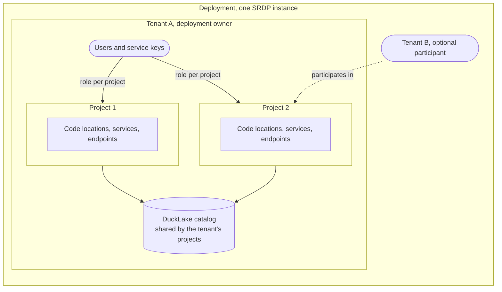
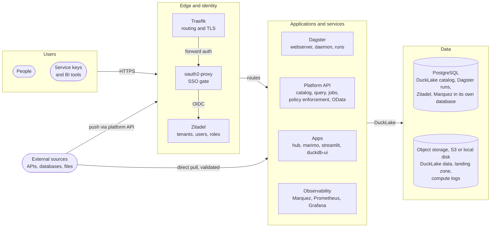
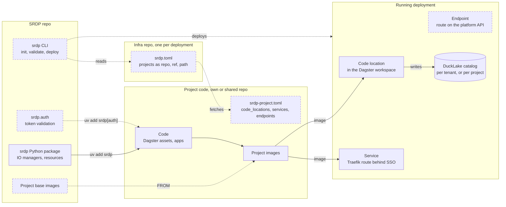

# Platform model

SRDP stands for Single-Repo Data Platform.
One repo holds every part of the platform.
These parts are the Python package, the platform images, the Docker Compose stack, the Helm chart and the infrastructure code.
We version and release these parts together, so they always fit each other.
This is what "single repo" means.
The idea comes from [Instant OpenHIE](https://openhie.github.io/instant/), which packages a health information exchange the same way.

Your deployment configuration and your project code stay outside the platform.
They connect to it through configuration files, the `srdp` CLI and the `srdp` Python package.
You choose how to split them over repos.
This page explains how deployments, tenants and projects relate, and how they connect to the platform.

Solid boxes and lines in the diagrams exist today.
Dashed ones are in an ADR, and we have not built them yet.

## Base concepts

- A **deployment** is one running SRDP instance. It has its own Zitadel, PostgreSQL and storage. No tenant, project or role crosses from one deployment to another.
- A **tenant** is an organization in Zitadel. It has its own users and service keys. One tenant owns the deployment, and by default it is the only tenant.
- A **project** is a set of Dagster code locations, services and API endpoints. A tenant owns it. Users and service keys get a reader, writer or admin role per project.

A project and a repo are different things.
You choose which repo holds the code of a project.

[ADR-0005](adr/0005-authorization-and-data-access.md) and [ADR-0006](adr/0006-deployment-and-project-isolation-model.md) define these concepts.
The [architecture page](03-architecture.md) gives the full access model.

## Repository model

The SRDP repo contains the platform.
A deployment uses it as a package and as platform images.
A deployment does not fork it.

Each deployment has one `srdp.toml` in its infra repo.
This file lists the projects.
Each project declares its code locations, services and endpoints in `srdp-project.toml`.
The deployment, the platform and the projects connect only through the `srdp` CLI, these two files and the `srdp` Python package.

`srdp.toml` refers to each project by repo, ref and path.
A project can have its own repo.
Several projects can share a repo.
A small deployment can keep everything in one repo.
Git access, tags and releases follow the split you choose.
Zitadel controls access in the running platform per project.
The repo split does not change this access.

Projects depend on the public API of the `srdp` package, which uses semver ([ADR-0001](adr/0001-platform-architecture-and-distribution.md)).
From version 1.0, a project pins a major version.
A deployment pins the platform image version.

You can clone the SRDP repo for more control.
The secure defaults stay on.
To switch one off, you add an explicit line to `srdp.toml`.
We have not built these switches yet.
Today the `just` recipes need a clone.
The planned CLI removes that need.

## Platform components

Every deployment runs the core services.
Optional services stay off until you enable them.

External data enters through the platform API and the landing zone.
A Dagster asset can also pull data.
The asset must validate the data before it loads it.
Only Dagster writes to DuckLake ([ADR-0004](adr/0004-data-organization-and-ingestion.md)).
We have not built policy enforcement, OData, the landing zone, Prometheus and Grafana yet.
We have also not built the project roles in Zitadel or read-only DuckLake access for apps.
Until then, the rule that only Dagster writes is a design rule that the platform does not enforce.
The IO manager already writes DuckLake data to local disk or to S3.

## Configuration

`srdp.toml` sets up the deployment and lists its projects.
`srdp-project.toml` declares the code locations, services and endpoints of a project.
Secrets stay out of both files.
[ADR-0011](adr/0011-project-onboarding-and-extension.md) describes both files.
Today `srdp.toml` only sets the image registry and the setup databases.

## Deploying a project

A deployment needs three things.

- `srdp.toml` describes the deployment.
- Prebuilt images run every service, each at a pinned version. Platform images come from ghcr.io. Project images come from the registry in `srdp.toml`.
- The `srdp` CLI turns them into a running platform on Docker Compose or on any Kubernetes cluster.

You can run the full platform on your own machine to try it out, as the [configuration guide](02-configuration.md) shows.

You can reuse tools that you already run.

- PostgreSQL and object storage connect through configuration, so you can use a managed database or your own S3 bucket ([ADR-0001](adr/0001-platform-architecture-and-distribution.md)).
- Zitadel stays the token issuer, but it can sign users in through your existing identity provider, such as Entra ID.
- The Helm chart installs on your own cluster, and OpenTofu is only needed when SRDP creates the cluster.

The project publishes its images and declares its code locations, services and endpoints in `srdp-project.toml`.
The deployment lists the project in `srdp.toml`.
`srdp validate` checks both files.
`srdp deploy` creates the Dagster workspace and the Traefik routes and applies them.
You can run it again safely on a running platform.
Then you give users and service keys a role on the project in Zitadel.
Until the CLI exists, you edit the workspace and the routes by hand.
